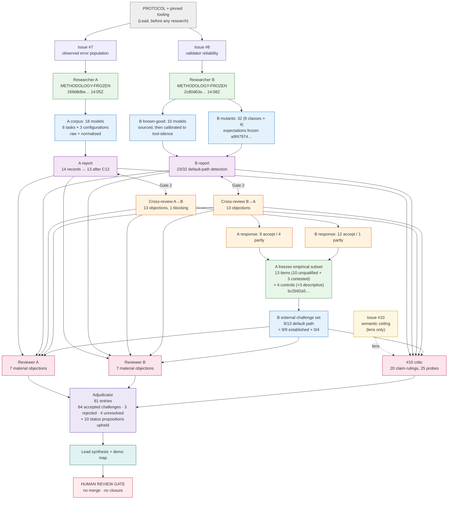

# Student-facing demonstration map — how this pilot was actually decided

This map shows the **sequence of research decisions and the evidence dependencies** of the
#7 × #8 relational pilot: what was decided when, what evidence the decision rested on, and what
would have been impossible to claim if an earlier gate had failed. It is written to be read before
the reports, not after.

Up: [`README.md`](README.md) · Process protocol: [`PROTOCOL.md`](PROTOCOL.md) · Findings:
[`reports/relational-demo-synthesis.md`](../../reports/relational-demo-synthesis.md) · Rulings:
[`adjudication/ADJUDICATION.md`](adjudication/ADJUDICATION.md).

---

## 1. The sequence, as decisions rather than dates

Each row is a decision point. The "what it constrained" column is the point of the map: a decision
early in the chain removes options later, and that is what a method is.

| # | Decision point | Decision made | Evidence behind it | What it constrained later |
|---|---|---|---|---|
| 0 | Scope | Two bounded pilots, #10 as a lens, stop at human gate | The human's brief; the issues' own exclusion lists | Neither issue can be closed; no new question may be opened |
| 1 | Tooling | One pinned open validator (OpenSysML `v0.12.1`, sha256 pinned); Syside excluded as a licence boundary; OMG pilot excluded for lack of a JVM/CLI asset | `TOOLING.md`; a pre-run smoke test; the release-asset list | Every #8 rate is a one-instrument calibration, and the reports must say so |
| 2 | Independent method freeze | Both researchers hash a method before either sees the other's results (14:05Z / 14:08Z) | The two frozen files and their hashes | Hindsight-fitting is excluded as an explanation; later changes must be dated amendments |
| 3 | Corpus construction | A: 18 self-generated models with raw wrappers preserved; B: 10 known-good bases (9 quoted from the specification, all calibrated against the tool before the freeze) and 32 synthetic mutants | `corpus/manifest.csv`; `known-good/*.PROVENANCE.md`; `mutants/MANIFEST.csv` | A's frequencies are corpus properties, not population estimates; B's mutants are specification-flavoured, not generation-sampled |
| 4 | Ground truth named before measurement | A codes errors before running the validator; B writes expected detectability before running it | Frozen CSVs and hashes | Validator verdicts cannot define the truth they are measured against — with the caveat that A's hash was never taken (found later) |
| 5 | Cross-review (Gate 2) | A challenges B's mutant realism; B challenges A's classification precision | 26 objections, each re-tested by the target | A blocking error in B's headline and a phantom record + unsupported hash claim in A's were caught here |
| 6 | Revision under challenge | Both accept almost everything and record what changed; originals stay visible | `A-response…`, `B-response…`; dated addenda | The corrected claims are narrower, and the corrections themselves are auditable |
| 7 | External challenge set | A freezes 13 observed errors (10 unqualified + 3 contested) + 4 controls and 3 descriptive models; B runs them as a *separate* arm | `empirical-subset/` hash `bc2b92a5…` | Tests B's faults against errors that actually occurred, without merging denominators |
| 8 | Independent review (Gate 3) | Two reviewers + a #10 critic, each with fresh context and no stake | Re-runs of scripts; 42 models re-validated; 122 probe invocations | Stale headlines, a gate-dependence, a post-AM1 hash and 8 overstated claims were caught |
| 9 | Adjudication (Gate 4) | 81 entries on documented evidence; majority and authority inadmissible | Pinned hashes; re-run binary; retrieved KerML/SysML text | 64 accepted challenges, 3 rejected, 4 unresolved, and 10 critic status propositions upheld (the JSON groups the ten upheld under `ACCEPTED`, which is why its counters read 74/3/4) — and the synthesis may not average the unresolved ones |
| 10 | Synthesis | Lead writes only after Gate 4 | The adjudication, not the reports | The record ends at a human gate; nothing is merged or closed |

---

## 2. Evidence dependencies: what each claim rests on

Read the left column as "claim", the middle as "the bytes that support it", the right as "what would
invalidate it".

| Claim | Evidence it rests on | Invalidated if… |
|---|---|---|
| A: 18/18 raw outputs wrap the model in markdown | `raw/*.md` preserved verbatim + `corpus/manifest.csv` fence metadata | a raw file was edited; the second coder's W1 reading differs (recorded, not material) |
| A: wrapper removal alone does not fix the corpus | `normalized/` + `extraction-log.json`; validator runs on both | the extraction script added or repaired model text — reviewer re-ran it, byte-identical |
| A: inspection missed 6 real notation defects | `errors-post-inspection.csv` + the notation productions cited | those records were surfaced by the tool (they were — hence labelled descriptive, not recall) |
| A: detection is 9/14 (registered), 9/9 on established+mandatory | `detection/summary.csv` + the catalogue's obligation column | the obligation reading or the record status changes — both were adjudicated and the ladder is now printed |
| B: 23/32 default-path detection | 32 mutant files + `results/raw/run1` + `analysis.py` | a mutant is not single-defect, or the scoring rule differs — reviewer diffed and re-ran |
| B: 0/10 known-good error-level diagnostics (a **calibration probe**, not a false-positive rate) | known-good models with provenance + `known-good-triage.md`; the bases were calibrated against the tool before the freeze (`B-22`) | the arm is treated as an independent false-positive sample — it was tuned to the instrument, so it cannot estimate one |
| B: external 9/13 = 9/9 established + 0/4 discretionary/contested | `empirical/results.csv` + A's frozen subset | the subset items change status (R1 is unresolved; 9/11 rung shown) |
| Critic: six semantic properties are decided under some invocation | 25 probe models + 122 raw invocations + `RUNLOG.tsv` | a probe is invalid — one was, and is recorded as a failed control |
| Both: the layer boundary replicates | A's corpus (independently *generated*) and B's mutants (independently *authored*, from the specification) | the layer and the specification's obligation status are confounded — the adjudicator ruled this **unresolved** |
| Adjudicator: 64/3/4 | `rulings.json`, one record per challenge with evidence | a ruling is shown to misread its cited evidence — none was found on re-check |

---

## 2a. Two senses of "independent" — read this before quoting either arm

The map uses the word *independent* in a narrow, procedural sense. It does not mean either pilot
measured anything blind, and the adjudicated reports say so. Three different things are at stake:

| Sense | What it means here | What it supports | What it does not support |
|---|---|---|---|
| **Independently sourced evidence** | The text under test was not authored to fit a verdict: A's raw generation outputs, the specification text B quotes, the external corpus A checks against | Claims about what the model text contains, and what the tool does to text it did not write | Claims about a population — these are 18 models and one generator family |
| **Independently authored test cases** | A third party wrote the case from the specification, not from the tool's behaviour: B's 32 mutants and expectations, authored before the run | Direction and mechanism of detection (which classes are caught, at which layer) | False-negative rates for "validators" — the mutants are synthetic and construct-shifted |
| **Calibrated test cases** | The case was selected or adjusted against the instrument before the freeze: B's 10 known-good bases were iterated to tool-silence (`B-22`) | That the tool can validate these models cleanly; a consistency check | A false-positive *rate*: a corpus tuned to pass cannot measure how often unrelated models fail |

What follows for the two most-cited numbers:

- **B's 0/10 known-good arm is a calibration probe, not a specificity estimate.** The bases were
  quoted from the specification, but B iterated them until the tool was silent before freezing. That
  makes a diagnostic on them informative, and makes a clean run expected. The report now says this;
  the map should not imply otherwise.
- **A's 18-model corpus is not blind either.** It was generated by the same model family that coded
  it. Its value is that the outputs were not edited after generation and that the coding was frozen
  before the validator ran — procedural independence, not epistemic independence.

The one check whose *text* neither researcher produced is A's secondary corpus (LaVoie et al.),
a public release of generated models. A selected it against pre-registered criteria and ran the
instrument on it, so the analysis is not blind either; the text is. It is also the check that
produced a class (`name-conflict`) neither primary corpus contained, which is why externally
sourced evidence matters here — and why its small size is a limit, not a decoration.

---

## 3. Where a gate could have stopped the work

A gate is not a formality if it can fail. Each of these was a real failure mode:

- **Gate 1 (freeze)** would have failed if B had seen A's corpus before freezing, or if either file
  had been edited later. It passed; the hash pair and the times are in
  [`gate-log.md`](gate-log.md). The disclosed pre-freeze *tool calibration* is the near-miss: B had
  seen the tool fire on F6/F8 mechanisms before writing expectations. It was disclosed, ruled on,
  and the audit was relabelled "informed, not blind".
- **Gate 2 (cross-review)** would have failed if the challenges were vague or the responses were
  defensive. In fact A falsified B's headline with one command, and B found a record in A's data
  that cited a port the model does not contain. Both were accepted and both changed the documents.
- **Gate 3 (independent review)** would have failed if reviewers merely agreed. Reviewer A's
  strongest finding — 9/9 on established records — contradicts A's interpretation; Reviewer B's
  strongest finding — the pre-registration hash post-dates the run — contradicts B's evidence
  claim. The #10 critic then contradicted *both* pilots' framing of the ceiling, with probes.
- **Gate 4 (adjudication)** would have failed if it had split differences. It rejected 3 challenges,
  including two sub-claims made by reviewers, and refused to treat the 9/9 correction as proof of
  reliability (it is post-hoc and covers only the layers the tool is known to reach).

---

## 4. Reading path (about 40 minutes)

1. This map.
2. [`reports/relational-demo-synthesis.md`](../../reports/relational-demo-synthesis.md) — what
   changed because of challenge.
3. [`reports/issue-007-error-taxonomy-pilot.md`](../../reports/issue-007-error-taxonomy-pilot.md)
   §1, §5, §16–§17 — note the "current numbers" table and the corrections register.
4. [`reports/issue-008-validator-reliability-pilot.md`](../../reports/issue-008-validator-reliability-pilot.md)
   §1–§4 and addenda A1–A10 — track how "no evidence at all" becomes the encoding-dependent claim.
5. [`cross-reviews/`](cross-reviews/) — the two reviews and the two responses, in that order. This
   is where the work actually changed.
6. [`reviews/`](reviews/) and [`critique/`](critique/) — the objections and the ceiling probes.
7. [`adjudication/ADJUDICATION.md`](adjudication/ADJUDICATION.md) §5 — the unresolved questions and
   what would settle them.
8. If you want to check the claim yourself:
   [`empirical-subset/subset.json`](empirical-subset/subset.json) (hash-verified) and
   [`TOOLING.md`](TOOLING.md) (pinned binary).

---

## 5. Three questions a student should be able to answer after reading

1. **Which claim changed because of *whom*, and on what evidence?** (Example: B's "invisible
   structural defects" changed because A ran a mode B had quoted but never executed; the evidence
   was exit 1 versus exit 0 on the same pair of models.)
2. **Which claims survived challenge, and why is "it survived" weaker evidence than "it was
   attacked and reproduced"?** (Example: B's 23/32 survived because a reviewer re-ran the binary
   over all 42 models and recomputed the intervals, not because the number looked plausible.)
3. **What is still unresolved, and what would settle it?** (Four items, each with a named settle
   route in the adjudication — an RTF/expert ruling, a crossed mutant design, or an afternoon of
   invariant mutants. A majority vote is not among the routes.)

---

*This file is part of the pilot record. See [`PROTOCOL.md`](PROTOCOL.md) §4 for the gate definitions
and [`gate-log.md`](gate-log.md) for the timestamped evidence that each gate passed.*
